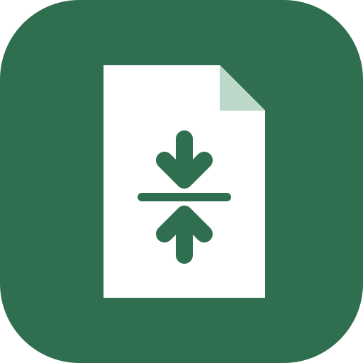

  

# PDF Toolkit

A private, all-in-one PDF tool that runs entirely in your browser. Compress a PDF, sign it, fill in forms, rearrange pages, turn it into an e-book, and pull out or change the things inside it, all on your phone or computer.

**Your files never leave your device.** Nothing is uploaded anywhere.

---

## Getting started

1. Open the app and tap **Choose a PDF** (or drag a file onto the page).
2. Use the tabs at the top to pick what you want to do:
   - **Compress** – make the file smaller
   - **Sign & edit** – add signatures and text
   - **Pages** – reorder, rotate, delete, duplicate, merge
   - **Elements** – work with the images, text, fonts and other parts inside the PDF
   - **ePub** – turn the PDF into an e-book with chapters and a table of contents
3. Save your result. On a phone you may see a confirmation prompt or a share sheet. That is normal.
4. Tap **← New file** to start over with a different PDF.

> **Tip:** Changes from one tab carry over to the others. For example, a signature you add in *Sign & edit* is included when you compress the file afterwards.

---

## Compress

Makes your PDF smaller by shrinking its pictures. **Text stays text**, so it remains sharp and searchable.

- The app scans your file and shows **five levels**: Minimal, Light, Balanced, Strong and Maximum.
- Each level shows an **estimated size** and how much smaller it would be. One level is marked **Recommended**.
- Pick a level, tap **Compress**, then **Save compressed PDF**.

Good to know:
- If your file is mostly text, there is little to gain, and the app says so.
- Pictures already stored in very efficient formats (such as JPEG 2000 or scanned-document formats) are left alone.
- Estimates are approximate. The real size is shown when it finishes.
- Keep the app open and in front while it works. Switching apps can pause it on phones.

---

## Sign & edit

Add things on top of your pages: signatures, text, and text for forms.

The toolbar at the top stays on screen as you scroll:
- **Signature**, **Text box**, **Mono box**
- **Save PDF** and **Go to Compress**

**Signatures**
- Draw one with your finger, or tap **Import image** to use a photo or scan of your signature on white paper. The white background is removed for you.
- Up to 12 signatures are remembered in this browser so you can reuse them.
- Tap a signature to select it, then drag the green **Move** button to reposition it, and drag the round corner handle to resize it. Use the rotate buttons or slider to turn it.

**Text boxes**
- Resizable, with several lines of text.
- Choose Helvetica, Times or Courier, set the size and colour, and use **B / I / U** and left, centre or right alignment.

**Mono boxes**
- For form fields. Stretch the box over a field and the letters spread evenly across it.
- Set **Character cells** to match the number of squares in a comb-style field.

Every item also has a **Duplicate** button and a red **Delete** button.

> Items stay on the page where you added them.

---

## Pages

Shows a thumbnail of every page.

- **Tap a page** to select it. Under each thumbnail are buttons to move it earlier or later, **rotate**, **duplicate** or **delete** it.
- **Move page to…** jumps a selected page to any position.
- **Insert blank** adds an empty page after the selected one.
- **Add PDFs** merges other PDFs onto the end, where you can reorder them like any other pages.
- **Undo** steps back through your changes.
- Nothing is final until you tap **Apply** (or **Apply & save**).
- **Save pages** lets you export a range such as `1-3, 5, 8-` as one PDF, or each page as its own file in a ZIP.

---

## Elements

Work with the individual things inside the PDF. Use the dropdown at the top to choose what to look at. The toolbar stays on screen and includes **Undo** and **Redo** (the last 10 changes) and **previous / next page** buttons.

| Section | What you can do |
|---|---|
| **Images** | See each page's images, with the page shown above and the selected image highlighted. **Save** one (or all as a ZIP), **Replace** it with your own, make it **Gray**, or **Delete** it. |
| **Text** | Tap a piece of text to select it. Edit it, delete it, **Copy** it, or **Save .txt** for the whole document. |
| **Annotations** | Comments, links, highlights and form fields, page by page. Delete one, or all of one type. |
| **Files** | Save or remove files attached inside the PDF. |
| **Fonts** | Save the fonts embedded in the PDF. For CFF fonts, **Save .otf** produces a font file that opens in normal font tools. |
| **Bookmarks** | See and remove the bookmark outline. |
| **Info** | Edit or strip the document details (title, author and so on) and remove embedded JavaScript. |
| **Capture** | Drag a box over any part of a page and save it as a **PNG** picture or a **cropped PDF**. |

**Editing text**
- Edited text uses the PDF's original font when that font has every letter you typed. Otherwise a standard font (your choice in the dropdown) is used, and the app tells you.
- **Keep width** (on by default) adjusts spacing so the new text takes up the same width as the old.
- Text inside scanned images can't be edited, because it is a picture.

> A cropped PDF from **Capture** still contains the rest of the page. Don't use it to hide private information.

---

## ePub

Turns the PDF into an EPUB 3 e-book you can read on a Kindle (send it with *Send to Kindle*), Kobo, Apple Books, Boox or any other reader.

- **Real paragraphs.** Lines the PDF broke at the margin — and at the page edge — are joined back into whole sentences. Words hyphenated across a line are repaired. Bullets and numbers stay on the same line as their text, and hanging indents stay inside one list item.
- **Chapters and a table of contents.** Section headings become chapters; smaller headings become nested entries you can tap.
- **Running heads, feet and page numbers** are detected and removed.
- **Pictures are kept.** Graphs, charts, diagrams and illustrations are found on each page and cropped, then placed between the paragraphs they belong to. This works for pictures embedded in the PDF and for drawings made of vector shapes. Full-page backgrounds, watermarks, rules and logos in the margins are left out. Pages that are one big picture (scans) come through as page images.
- **Tables become real tables.** Ruled tables are reconstructed from their grid lines and borderless tables from their aligned columns, including two-column tables, two-row tables, and tables with alternating shaded rows — shaded and plain rows are kept together, and a header that wraps over several lines is folded back into one header row. Each cell is read on its own, so wrapped cell text stays in one cell instead of running across the page, and the EPUB gets a proper table with a header row.
- **Two-column pages** are read one column at a time, so the text stays in order.
- **Scanned pages can be read with OCR.** Tick **Read the text with OCR** and pages that are pictures of text become real, searchable text. Pick the OCR language from the dropdown (English by default).
- **Footnotes** at the bottom of a page are moved to a **Notes** section at the end of the chapter.
- **Contents pages are kept.** A printed table of contents becomes its own chapter, with each title and its page number on one line instead of numbers being glued to the text or turned into headings.
- Title, author and language are filled in from the PDF but you can change them before converting.
- Bold and italic text is kept where the PDF's fonts identify it.

**Scanned pages: text or picture?**
- Before OCR, each textless page is examined. A page that is mostly white with regular dark lines is treated as a picture of text and read with OCR. A colourful or busy picture — a photo, a plate, a map, a comic panel — is kept as an image and OCR is not wasted on it.
- When a page is read with OCR, the text replaces the page picture by default. That keeps the EPUB small, reflowable and searchable, and stops the reader from showing the same page twice.
- **Keep the page picture too** puts the scan after its text. That is useful when you need the original for checking names, numbers, tables or formulas, but it roughly doubles the size of those pages, so it is off by default.
- If OCR is not confident about a page, the picture is kept alongside the text automatically, so nothing is lost.

- **Table detection is careful.** Pages that only look like tables — two columns of prose, diagrams with boxes, figure labels — are left as text or pictures. Merged cells are approximated: a cell that spans several columns appears as an empty cell next to the filled one.

Good to know:
- **OCR is opt-in.** The engine is about 15 MB and is downloaded the first time you use it, plus one language file; the page itself never leaves your device. Scans that are not read stay as images, and their text can't be searched.
- **OCR is not perfect.** Check names, numbers and small print against the page pictures if accuracy matters. Store books with DRM are not supported.
- **Detection is heuristic.** Unusual layouts (poetry, tables, sidebars, three-column pages, comic panels) can come out in the wrong order. Check the result in your reader.
- **The EPUB is a new file.** It doesn't replace the PDF in the app; the other tabs still work on the PDF.
- **Pictures add weight.** Keeping every figure makes a bigger EPUB. Untick **Keep figures and scanned pages** for a text-only book.

---

## Good to know

- **Encrypted files.** Many PDFs are "encrypted" only to restrict printing or copying and open without a password. The app can open these. A PDF that genuinely needs a password cannot be opened.
- **Scanned PDFs.** Text in scanned pages is a picture, so it can't be selected or edited. The **ePub** tab can read those pages with OCR and make searchable text.
- **Your work is protected.** The app saves your file and your added items on your device as you go. If the page reloads, you'll be offered **Restore your last session**. A back swipe asks you to confirm before leaving.
- **Saved signatures** are stored in this browser only, so they won't appear on another device.
- **Fonts and licences.** Fonts inside a PDF are usually licensed for that document only. Check the licence before installing or sharing them.
- **Very large files** can be slow on a phone.

---

## Troubleshooting

| Problem | What to try |
|---|---|
| "Needs a password" message | The PDF has a real password. Remove it in another app first. |
| Save does nothing | Check the confirmation prompt or share sheet. If your browser blocks saving, open the app's link in a desktop browser. |
| Compression doesn't shrink much | The file is probably mostly text, or its images are already efficient. |
| Text in the Text section is missing | The text may be part of a scanned image, or use a font the app can't read. |
| EPUB paragraphs run together or split oddly | The page layout is unusual (tables, poetry, sidebars). Try a different PDF or fix the paragraphs in a reader or editor. |
| EPUB has no chapters | The PDF has no headings the app can recognise. Long books are split into parts instead. |
| OCR does nothing | Tick **Read the text with OCR**, and make sure the page really is text. Photos, plates and diagrams are deliberately left as images. |
| A table came out as plain paragraphs | The table has no rules and its columns are not aligned, or it sits inside a scanned page. It is kept as text; tables in scans are not rebuilt. |
| A picture is missing | Backgrounds and full-page tints are dropped on purpose. Art that is part of the page background cannot be separated from it. |
| OCR text has mistakes | Recognition is best-effort. Try a higher-quality scan, or turn on **Keep the page picture too** to compare. |
| Something looks off after an edit | Use **Undo** in Elements. The original file on your device is never changed. |
